<p align="center">
  
</p>

<p align="center">
  <a href="https://github.com/ishandutta2007/Awesome-Awesome-Awesome"></a><a href="https://discord.gg/jc4xtF58Ve"></a>
  <a href="https://github.com/ishandutta2007/Awesome-Precision-Agricultural-Fertilizer-Orchestration/stargazers"></a>
  <a href="https://github.com/ishandutta2007/Awesome-Precision-Agricultural-Fertilizer-Orchestration/network/members"></a>
  <a href="https://github.com/ishandutta2007/Awesome-Precision-Agricultural-Fertilizer-Orchestration/issues"></a>
  <a href="https://github.com/ishandutta2007/Awesome-Precision-Agricultural-Fertilizer-Orchestration/blob/main/LICENSE"></a>
  
  <a href="https://github.com/ishandutta2007"></a>
</p>

---

# 🌱 Awesome Precision Agricultural Fertilizer Orchestration 🛰️

> **A curated directory of top-tier SaaS platforms, open-source agronomic engines, and GIS tools designed for Variable Rate Application (VRA), satellite-derived vegetation indices, multi-layer nutrient zoning, and autonomous fertilizer prescription mapping.**

Modern precision agriculture bridges satellite remote sensing (Sentinel-2, Landsat, Planet Labs), ground IoT sensors, soil electrical conductivity (EC), and dynamic crop growth simulation models. By analyzing intra-field spatial variability, these solutions generate high-precision variable-rate prescriptions (VRA) for Nitrogen (N), Phosphorus (P), Potassium (K), and lime—optimizing crop yield, cutting chemical input costs by 15–30%, and eliminating environmental nutrient leaching into freshwater ecosystems.

---

## 📑 Table of Contents

- [📊 Sector Overview & Market Dynamics](#-sector-overview--market-dynamics)
- [💻 SaaS & Commercial Platforms](#-saas--commercial-platforms)
- [🔓 Open-Source GitHub Projects](#-open-source-github-projects)
- [🛠️ Agronomic Frameworks & Architecture Blueprint](#️-agronomic-frameworks--architecture-blueprint)
- [🤝 How to Contribute](#-how-to-contribute)
- [📈 Star History](#-star-history)
- [💖 Support & Community](#-support--community)
- [⚠️ Disclaimer](#️-disclaimer)

---

## 📊 Sector Overview & Market Dynamics

The global precision agriculture industry was valued at approximately **$9.5 billion in 2023** and is projected to expand to **$21.5+ billion by 2030**, advancing at a compound annual growth rate (**CAGR of 12.8%**). Within this sector, the specialized sub-market for **Variable Rate Technology (VRT), nutrient zoning algorithms, and automated fertilizer prescription orchestration** accounts for roughly **$3.2 billion**, driven by rising raw synthetic fertilizer costs, stringent international environmental regulations (e.g., EU Farm to Fork targets requiring a 20% reduction in fertilizer usage), and severe grain market volatility.

### 🌐 Market Fragmentation vs. Concentration Dynamics

The fertilizer orchestration sector exhibits a **moderately fragmented, bifurcated structure** rather than a winner-take-all monopoly:

1. **OEM Hardware & Input Monoliths (Anchor Layer):** Conglomerates like **Deere & Company** (machinery telematics), **Bayer Crop Science / Climate FieldView** (seed/chemistry integration), and **Yara International** (fertilizer distribution) dominate the base layer. They offer broad ecosystem integration and hardware lock-in through tractor cabs and retail dealer distribution networks.
2. **Specialized Independent AgTech SaaS (Algorithmic Innovation Layer):** Pure-play innovators such as **Taranis** (sub-millimeter leaf AI), **CropX** (in-soil root-zone IoT telemetry), **Semios / Agworld** (permanent crop orchestration), and **OneSoil** (satellite-driven micro-zoning) capture substantial market share by delivering OEM-agnostic workflows, higher spectral resolution, and interoperability across mixed equipment fleets.
3. **No Single Winner-Take-All Platform:** Because agricultural operations regularly run mixed machinery fleets (e.g., John Deere tractors pulling Case IH or Amazone spreaders with Trimble controllers) and must accommodate regional micro-climates and localized soil chemistry, total ecosystem lock-in remains impossible. This structural dynamic sustains a vibrant market for specialized agritech startups and community-governed open-source stacks.

---

## 💻 SaaS & Commercial Platforms

The following table summarizes the category leaders in precision agricultural fertilizer orchestration. The table is ranked in descending order by **Company Valuation / Market Capitalization / Annual Revenue**.

| Platform / Company | Valuation / Revenue / Size | Starting Tier Pricing | Free Tier Limit / Free Trial | Key VRA & Fertilizer Capabilities |
| :--- | :--- | :--- | :--- | :--- |
| **[John Deere Operations Center](https://www.deere.com/)** | **~$115B Market Cap**<br>*(NYSE: DE; ~$55B+ Annual Revenue)* | **$0.00 / Free Base Platform**<br>*(JDLink telematics included with compatible machinery; partner sync fees vary)* | **Free Forever Plan:**<br>Unlimited field boundaries, machine telematics tracking, and field map visualization for all registered accounts. | Direct wireless sync to Gen 4/G5 tractor in-cab displays; multi-layer yield mapping; ISOXML/Shapefile variable-rate prescription export; equipment fuel and rate telemetry. |
| **[Climate FieldView](https://climate.com/)**<br>*(Bayer Crop Science)* | **~$28B Market Cap**<br>*(Bayer AG; Climate Corp acquired for $1.0B cash; ~$25B Crop Science Rev)* | **$99.00 / year**<br>*(FieldView Plus base tier; custom fertility scripting add-on at $1.00–$1.50/acre)* | **FieldView Basic (Free Forever):**<br>Manual boundary drawing, scouting notes, field-level weather, and satellite imagery (excludes cab streaming & VRA scripts). | Real-time in-cab FieldView Drive rate recording; automatic nitrogen monitoring; fertility and seeding prescription scripting engine; hybrid split-rate trial analysis. |
| **[Yara Atfarm](https://www.yara.co.nz/crop-nutrition/farmers-toolbox/atfarm2/)**<br>*(Yara International)* | **~$9.5B Market Cap**<br>*(OSLO: YAR; ~$15B+ Annual Revenue)* | **$0.00 / 100% Free**<br>*(Software subscription fees eliminated; free access for all registered farm accounts)* | **Free Forever Full Access:**<br>Requires minimum field size of **1.0 hectare** (50m min length/width) and supported crop type. *(N-Tester BT hardware sold separately).* | Calibrated Yara N-Sensor algorithms on Sentinel-2 satellite imagery; automated variable-rate nitrogen prescription maps; smartphone GPS flow-rate applicator for spreaders without VRA terminals. |
| **[Semios](https://semios.com/)** | **~$1.0B Valuation**<br>*(AgTech Unicorn; $225M+ venture raised from Morningside Group; acquired Agworld)* | **$60.00 / acre / year**<br>*(Starting baseline for orchard IoT; intensive setups scale to $120–$150/acre/yr)* | **1-Season Field Pilot Demo:**<br>No perpetual free tier. Offers structured single-season trial block (typically 10–40 acres) via enterprise sales engineering. | In-canopy microclimate IoT sensor grids; continuous soil moisture profiling; automated variable-rate pheromone and fertigation delivery for high-value orchard crops. |
| **[Taranis](https://www.taranis.com/)** | **~$300M Valuation**<br>*(Raised $100M total venture funding; $40M Series D led by Inven Capital)* | **$5.00 / acre / season**<br>*(Broadacre row crops: corn, soy; specialty crops range $15.00–$20.00/acre/season)* | **Single-Flight Field Trial Pilot:**<br>No perpetual free tier. Provides customized 1-flight leaf-level AI scanning trial and advisory dashboard demo via retail agronomists. | Sub-millimeter aerial leaf-level AI photography (0.3mm/pixel); foliar nutrient deficiency identification; automated stand counts; weed/insect pressure and nitrogen stress zoning. |
| **[CropX](https://www.cropx.com/)** | **~$120M Valuation**<br>*(Raised $55M+ venture funding; $30M Series C led by Aliaxis; acquired Tule & Regen)* | **$300.00 / sensor / year**<br>*(Cloud software subscription; CropX Vertex in-ground sensor hardware at $695.00/unit)* | **14-Day Software Sandbox Demo:**<br>No perpetual free tier. 14-day software sandbox demo and pilot test bundles available via Reinke and OEM irrigation dealers. | Multi-depth spiral soil moisture and EC sensors; real-time nitrogen leaching telemetry; dynamic fertilizer timing based on root-zone percolation and transpiration. |
| **[Agworld](https://www.agworld.com/)**<br>*(A Semios Company)* | **~$100M Valuation**<br>*(Acquired by Semios in 2021; previously raised $11.5M in venture funding)* | **$1,495.00 / year**<br>*(Grower Basic tier; Grower Plus is $3,195/yr; Grower Pro is $3,995/yr billed annually)* | **Free Viewer Account:**<br>Free forever for growers to inspect agronomist VRA recommendations; **14-day full feature trial** available on request. | Collaborative agronomist-grower prescription workflows; spatial soil test overlay; multi-season nutrient budget tracking; farm financial gross margin tracking by VRA zone. |
| **[Sentera](https://sentera.com/)** | **~$100M Valuation**<br>*(Raised $50M+ venture funding; Series C led by CDPQ and S2G Ventures)* | **$500.00 / year**<br>*(FieldAgent base platform; specialized SmartScript™ VRA prescription exports at $0.25/acre)* | **FieldAgent Mobile (Free Forever):**<br>Free spot-scouting and field boundary markers; **30-day free trial** for high-resolution aerial stitching and prescription mapping. | High-resolution drone multispectral imaging (NDRE, NDVI); SmartScript™ automated variable-rate nitrogen map generation; precision weed mapping for targeted spot application. |
| **[Farmers Edge](https://www.farmersedge.ca/)** | **~$50M Valuation / $35M ARR**<br>*(Previously public on TSX at $17/share; taken private by Fairfax Financial in 2024)* | **$2.00 / acre / year**<br>*(Smart Core platform; full VRA fertility with physical zone soil sampling is $3.50–$4.50/acre/yr)* | **1-Year Free Partner Growth Program:**<br>Free enrollment for up to 1 full crop season for participating farm acreage, converting to standard annual contract thereafter. | Daily high-resolution satellite imagery; physical multi-depth soil fertility sampling; in-cab Can-Plug telematics; custom variable-rate NPK and liming prescriptions. |
| **[OneSoil](https://onesoil.ai/)** | **~$30M Valuation**<br>*(Raised $6.7M–$10M VC from PortfoLion and Bulba Ventures; 5M+ registered hectares)* | **$1.50 / hectare / year**<br>*(~€1.25/ha/year for OneSoil Pro VRA fertilizer and seeding activation pool, billed annually)* | **Free Forever Plan (No Hectare Cap):**<br>Unlimited field boundaries, Sentinel-2 NDVI updates every 3–5 days, offline scouting app, and hyperlocal weather; **14-day free trial** of OneSoil Pro. | 7-year satellite historical biomass productivity zoning; automated variable-rate nitrogen/potassium prescription map generator; trial control strips with yield uplift calculation. |

---

## 🔓 Open-Source GitHub Projects

An expanded, verified collection of open-source software, GIS toolkits, agronomic simulation engines, and machine learning pipelines powering precision agriculture and fertilizer orchestration.

> **Sorted in descending order by GitHub Stars.** Click any social star badge to visit the stargazers page for that repository!

1. **[QGIS](https://github.com/qgis/QGIS)** [](https://github.com/qgis/QGIS/stargazers)  
   *The premier open-source Geographic Information System (GIS).* The universal standard for precision agriculture spatial analysis, yield monitor data cleaning, multispectral raster calculation (NDVI, NDRE, EVI), multi-zone delineation, and Shapefile/ISOXML variable-rate prescription map generation.

2. **[FarmBot OS](https://github.com/FarmBot/farmbot_os)** [](https://github.com/FarmBot/farmbot_os/stargazers)  
   *The operating system running on FarmBot precision agricultural robots (Raspberry Pi).* Automates micro-scale precision agricultural operations including coordinate-specific seed placement, soil moisture monitoring, and millimeter-accurate micro-dose liquid fertilizer application directly to individual plant root zones.

3. **[FarmBot Web App](https://github.com/FarmBot/Farmbot-Web-App)** [](https://github.com/FarmBot/Farmbot-Web-App/stargazers)  
   *Full-stack web management interface for FarmBot precision agriculture.* Provides a visual 2D farm designer, automated sequence scheduler, soil sensor historical analytics, and automated watering/fertilizing regimes.

4. **[sentinelhub-py](https://github.com/sentinel-hub/sentinelhub-py)** [](https://github.com/sentinel-hub/sentinelhub-py/stargazers)  
   *Python library for downloading and processing satellite imagery using Sentinel Hub APIs.* Enables automated acquisition of European Space Agency (ESA) Sentinel-2 multispectral bands, cloud masking, and on-the-fly NDVI/biomass calculation required for dynamic within-field nitrogen zoning.

5. **[PCSE (Python Crop Simulation Environment)](https://github.com/ajwdewit/pcse)** [](https://github.com/ajwdewit/pcse/stargazers)  
   *Python implementation of classical Wageningen crop simulation models (WOFOST, LINTUL).* Simulates daily crop growth, phenological development, dry matter partitioning, soil moisture dynamics, and nitrogen demand under variable climate conditions for precision nutrient scheduling.

6. **[LiteFarm](https://github.com/LiteFarmOrg/LiteFarm)** [](https://github.com/LiteFarmOrg/LiteFarm/stargazers)  
   *Community-led, participatory farm management software developed at the University of British Columbia.* Designed for diversified farmers to track field plans, soil health, nutrient inputs, and organic certifications, featuring emerging modules for variable-rate irrigation and input management.

7. **[DSSAT CSM](https://github.com/DSSAT/dssat-csm-os)** [](https://github.com/DSSAT/dssat-csm-os/stargazers)  
   *Decision Support System for Agrotechnology Transfer (Cropping System Model).* World-renowned biophysical crop simulation model simulating over 42 crops. Models nitrogen cycling, mineralization, urea hydrolysis, nitrate leaching, and dynamic crop nutrient uptake across contrasting soil layers.

8. **[APSIM Next Generation](https://github.com/APSIMInitiative/ApsimX)** [](https://github.com/APSIMInitiative/ApsimX/stargazers)  
   *Agricultural Production Systems sIMulator (C# / Cross-Platform).* Advanced framework for modeling agricultural systems, soil carbon dynamics, nitrogen transformations, solute movement, and yield responses under site-specific variable-rate fertilizer management strategies.

9. **[Awesome Precision Agriculture](https://github.com/px39n/Awesome-Precision-Agriculture)** [](https://github.com/px39n/Awesome-Precision-Agriculture/stargazers)  
   *Comprehensive curated research collection.* Gathers foundational scientific papers, datasets, UAV algorithms, and deep learning architectures applied to remote sensing, yield prediction, and precision agriculture.

10. **[Agrobot Navigation](https://github.com/nesl/agrobot)** [](https://github.com/nesl/agrobot/stargazers)  
    *Neural-Kalman GNSS/INS Navigation for Precision Agriculture.* High-accuracy sensor fusion system combining GPS, IMU, and neural Kalman filtering to provide centimeter-level autonomous guidance for field sprayers and fertilizer applicator tractors.

11. **[AgGateway ADAPT Framework](https://github.com/AgGateway-ADAPT/ADAPT)** [](https://github.com/AgGateway-ADAPT/ADAPT/stargazers)  
    *Open-source foundational data interoperability toolkit for agricultural machinery (.NET).* Provides standard plugin architectures converting prescription maps and field operation data between proprietary formats (John Deere, Case IH, Raven, Ag Leader, Trimble, ISOXML).

12. **[Precision Agriculture ML Platform](https://github.com/atharval1/precision-agriculture-using-machine-learning)** [](https://github.com/atharval1/precision-agriculture-using-machine-learning/stargazers)  
    *Machine learning recommendation system.* Predicts optimal crop types and custom NPK fertilizer blends based on climatic indicators (temperature, humidity, rainfall) and soil nutrient laboratory assays.

13. **[ML Precision Agriculture Web App](https://github.com/emclaniyi/ML-Precision-Agriculture-Web-App)** [](https://github.com/emclaniyi/ML-Precision-Agriculture-Web-App/stargazers)  
    *Streamlit-based diagnostic web application.* Utilizes Support Vector Machines (SVM) and multi-class classification to diagnose crop nutrient deficiencies, calculate fertilizer application rates, and recommend intervention timelines.

14. **[CSIRO PAT QGIS Plugin](https://github.com/CSIRO-Precision-Agriculture/PAT_QGIS_Plugin)** [](https://github.com/CSIRO-Precision-Agriculture/PAT_QGIS_Plugin/stargazers)  
    *Precision Agriculture Tools (PAT) plugin for QGIS developed by Australia's national science agency (CSIRO).* Specializes in raw yield-monitor data cleaning, spatial interpolation (ordinary kriging), spatial variability mapping, and within-field management zone delineation for targeted fertilizer prescriptions.

15. **[Soil Moisture Prediction Satellite ML](https://github.com/Beckybams/Soil-Moisture-Prediction-from-Satellite-Data)** [](https://github.com/Beckybams/Soil-Moisture-Prediction-from-Satellite-Data/stargazers)  
    *Machine learning pipeline for satellite-derived soil moisture estimation.* Leverages multispectral satellite observations to model root-zone moisture variability without relying entirely on physical ground sensor grids.

16. **[CSIRO pyprecag](https://github.com/CSIRO-Precision-Agriculture/pyprecag)** [](https://github.com/CSIRO-Precision-Agriculture/pyprecag/stargazers)  
    *Python library for precision agriculture analytics.* Core geospatial toolkit powering automated spatial data cleaning, semi-variogram fitting, and zone-based VRA rate calculation across commercial broadacre farms.

17. **[Agri-Vision System](https://github.com/maknoonisar/agricultural-AI)** [](https://github.com/maknoonisar/agricultural-AI/stargazers)  
    *AI-driven agricultural intelligence platform.* Features interactive Mapbox geospatial visualizations, drone/satellite NDVI mapping, computer vision diagnostics, and automated resource optimization recommendations for variable-rate irrigation and fertilization.

18. **[Cropping Systems GIS & ML](https://github.com/halilunaziru73-creator/Operationalizing-GIS-and-Machine-Learning-across-Contrasting-Cropping-Systems)** [](https://github.com/halilunaziru73-creator/Operationalizing-GIS-and-Machine-Learning-across-Contrasting-Cropping-Systems/stargazers)  
    *GIS, remote sensing, and machine learning research pipeline.* Demonstrates spatial fertility mapping and empirical variable-rate NPK/liming prescriptions (validated across a 16.85 ha maize case study in Portugal, cutting lime consumption by 2.69 tons versus uniform application).

---

## 🛠️ Agronomic Frameworks & Architecture Blueprint

To build a sovereign, vendor-neutral **Precision Agricultural Fertilizer Orchestration Stack**, agronomists and developers can interconnect open-source components into a modular 5-stage pipeline:

```
┌────────────────────────────────────────────────────────────────────────┐
│                      1. REMOTE SENSING & DATA INGESTION                 │
│         Sentinel Hub Python (sentinelhub-py) + Soil EC Sensor Logs     │
└───────────────────────────────────┬────────────────────────────────────┘
                                    │
                                    ▼
┌────────────────────────────────────────────────────────────────────────┐
│                   2. SPATIAL CLEANING & ZONE DELINEATION                │
│         CSIRO pyprecag / PAT Plugin + QGIS Geospatial Processing       │
└───────────────────────────────────┬────────────────────────────────────┘
                                    │
                                    ▼
┌────────────────────────────────────────────────────────────────────────┐
│                   3. BIOPHYSICAL CROP & NUTRIENT SIMULATION             │
│            PCSE / WOFOST / DSSAT (Daily Nitrogen Uptake & Leaching)    │
└───────────────────────────────────┬────────────────────────────────────┘
                                    │
                                    ▼
┌────────────────────────────────────────────────────────────────────────┐
│                   4. VARIABLE-RATE PRESCRIPTION ENGINE                  │
│       VRA Multi-Zone NPK Rate Algorithms (Shapefile / GeoPackage)      │
└───────────────────────────────────┬────────────────────────────────────┘
                                    │
                                    ▼
┌────────────────────────────────────────────────────────────────────────┐
│                   5. MACHINERY INTEROPERABILITY DISPATCH                │
│       AgGateway ADAPT (.NET) ──> ISOXML TaskData / Machine Consoles     │
└────────────────────────────────────────────────────────────────────────┘
```

- **Data Ingestion:** Ingest Sentinel-2 L2A bottom-of-atmosphere imagery via `sentinelhub-py` combined with historical soil test lab data (pH, CEC, Organic Matter, Mehlich-3 Phosphorus, Potassium).
- **Zoning:** Run spatial clustering (k-means / spatial fuzzy c-means) via `pyprecag` or QGIS to segment fields into 3–5 homogeneous productivity zones based on multi-year NDVI biomass stability.
- **Nutrient Modeling:** Feed weather data and soil parameters into `PCSE` (WOFOST) or `DSSAT` to model crop nitrogen uptake requirements at specific phenological stages (e.g., V6–V8 split dressing in corn).
- **Prescription Map:** Calculate target NPK rates per zone (e.g., high-yielding zone = 180 kg N/ha, low-yielding zone = 120 kg N/ha).
- **Interoperability Dispatch:** Use `AgGateway ADAPT` to export standardized `TASKDATA.XML` (ISO 11783-10) for in-cab controllers (John Deere GreenStar, Case IH Pro 700, Trimble GFX, Topcon Horizon).

---

## 🤝 How to Contribute

Contributions to this ecosystem are warmly welcomed! To contribute:

1. **Fork this repository** to your personal GitHub account.
2. **Add or refine an entry** in `README.md` following the established table or list format.
3. Ensure entries include:
   - Tool/Project Name and official link
   - Specific pricing model (for SaaS) or GitHub repository link with stars badge (for Open-Source)
   - 1–2 factual sentences highlighting variable-rate fertilizer orchestration capabilities.
4. **Submit a Pull Request (PR)** with a clear title and description of your proposed additions.

---

## 📈 Star History

[](https://star-history.dera.page/#ishandutta2007/Awesome-Precision-Agricultural-Fertilizer-Orchestration&type=date&legend=top-left)

---

## 💖 Support & Community

Thank you for exploring and utilizing this precision agricultural resource! If you find this repository helpful in your agronomic workflows, research, or AgTech development:

- ⭐ **Star this repository** to improve discoverability across the agricultural tech community.
- 🍴 **Fork the project** and contribute additional open-source models, datasets, and tools.
- 📢 **Share this resource** with precision agronomists, digital farm managers, and crop consultants.
- ☕ **Support continuous maintenance:** If you'd like to support ongoing updates, new features, and community maintenance, please consider buying a coffee or sponsoring via the [GitHub Sponsor Dashboard](https://github.com/sponsors/ishandutta2007).

---

## ⚠️ Disclaimer

- This repository is a **community-curated index** intended for research, agronomic analysis, and software development purposes. Inclusion does not constitute a commercial endorsement.
- Precision fertilizer orchestration and chemical rate modifications must adhere to regional environmental protection regulations (e.g., EPA Clean Water Act, EU Nitrates Directive) and machinery manufacturer guidelines.
- **Prescription maps must be validated by a certified professional agronomist (CCA/CPAg)** against local ground-truth soil tests, historical yield monitor calibrations, and field scouting prior to operational machinery application.
